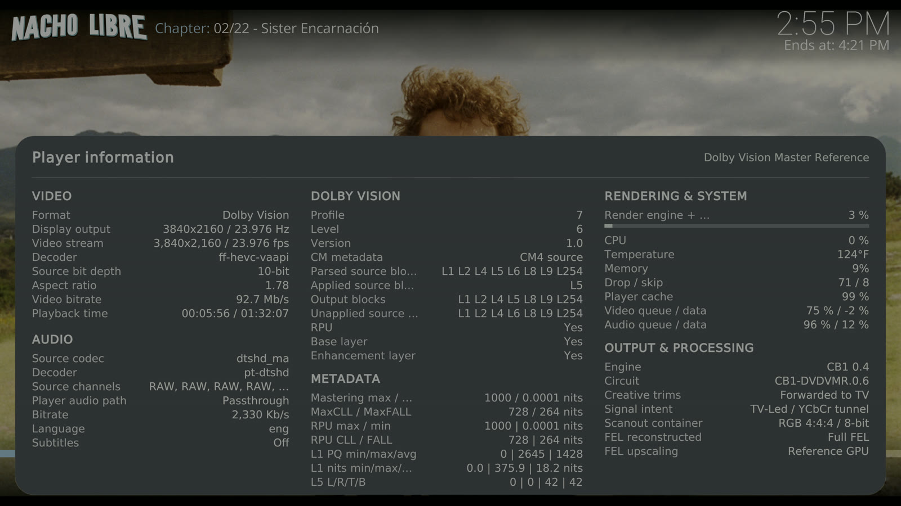

# kodi-standalone-dv-patch

Native Dolby Vision in a standalone Kodi on CachyOS with Plasma Bigscreen.
Tested on an AMD Radeon RX 9070 XT (DCN 4.01).

This repository does not contain the Dolby Vision work. It contains build instructions and
packaging only. The scripts get the patches from the original project at build time.

## Credit

All Dolby Vision, CB1 and DVBridge work is by **CroqueMr**:
**[CroqueMr/libreelec-x86-dv](https://github.com/CroqueMr/libreelec-x86-dv)**.
That project is a LibreELEC fork. It gives native Dolby Vision output on x86 GPUs.
Go to that project for the design, the documentation and the supported hardware.
Do not send problems with this port to CroqueMr. Open an issue here.

Other upstream projects:
[LibreELEC](https://libreelec.tv), [Kodi](https://kodi.tv),
[CachyOS linux-cachyos](https://github.com/CachyOS/linux-cachyos), [FFmpeg](https://ffmpeg.org),
[libplacebo](https://github.com/haasn/libplacebo).

## Status

Test system: AMD Radeon RX 9070 XT (DCN 4.01), Sony TV (direct HDMI), CachyOS with
Plasma Bigscreen, kernel `7.2.8-1-cachyos-cb1`, `kodi-cb1` pkgrel 8. Date: 2026-10-31.

| Test | Result |
| --- | --- |
| Profile 8.1, DV Standard | Pass (LibreELEC and CachyOS) |
| Profile 7 FEL, DV Master Reference, full FEL reconstruction | Pass (LibreELEC and CachyOS) |
| Profile 7 FEL with the HDMI 2.1 FRL kernel option (`amdgpu.dcfeaturemask=0x402`) | Pass |
| E-AC3 5.1 passthrough through ALSA, A/V sync | Pass |
| DTS-HD MA passthrough through ALSA | Pass |
| TrueHD Atmos passthrough through ALSA | Pass. The TV shows Dolby Atmos - TrueHD |
| ALSA HDMI device in the Kodi device list at each start | Pass (pkgrel 7) |
| CB1 Player information dialog | Pass (pkgrel 3) |
| Kodi start from Plasma Bigscreen, return to Plasma | Pass |
| Exit from the Kodi power menu | Pass (pkgrel 4 and later) |
| Restart Kodi from the Kodi power menu | Added in pkgrel 6. Not yet confirmed on hardware |
| `systemctl stop` stops Kodi | Pass (pkgrel 5 and later) |
| Passthrough through PulseAudio (PipeWire) | Partial: AC3, E-AC3 and DTS core only, with 250-500 ms audio delay. Use ALSA |
| Profile 5, kernel 7.3, CEC | Not tested |

This is experimental. CroqueMr does not list RX 9000 GPUs as supported. Use it at your own risk.

### Proof

Nacho Libre (2006), Dolby Vision Profile 7 FEL with DTS-HD MA, on the RX 9070 XT.
Kodi's CB1 Player information dialog shows:

- Dolby Vision Profile 7, **Full FEL** reconstructed, **Dolby Vision Master Reference**
- Decoder `ff-hevc-vaapi`, 3840x2160 at 23.976 Hz, RGB 4:4:4 8-bit tunnel
- Audio `dtshd_ma`, **Passthrough** (`pt-dtshd`)



The screenshot is Kodi's own capture of the frame buffer. The TV showed the Dolby Vision badge.

## Breakdown

The system has two parts: a patched kernel and a patched Kodi. Kodi does not run inside the
desktop. Kodi gets its own login session on tty7 and controls the display directly (KMS).
Dolby Vision needs this, because Kodi sets the DV HDMI properties on the display connector.
Plasma Bigscreen continues to run on its own VT. When you exit Kodi, the display goes back to
Plasma.

| Package | Contents |
| --- | --- |
| `linux-cachyos-cb1` (+ `-headers`) | CachyOS kernel 7.2.8 + 22 kernel patches from the fork + 3 patches from this repo |
| `cb1-ffmpeg` | FFmpeg 9.0 + the LibreELEC and fork patches |
| `cb1-libplacebo` | libplacebo `e2972fd` + 20 fork patches |
| `cb1-libdisplay-info` | libdisplay-info 0.4.0 (CachyOS has 0.3.0) |
| `cb1-lightgbm` | LightGBM 4.7.0 (for the CB1 HDR10 AI modes) |
| `kodi-cb1` | Kodi `28ea2ea` + 17 patches + CB1 from the fork, 2 patches from this repo, GBM/GLES, and the Bigscreen hand-off |

All packages except the kernel install in `/opt/cb1`. They do not replace the CachyOS Kodi,
FFmpeg or libplacebo. The kernel is a separate package. The stock `linux-cachyos` stays
installed as a fallback.

### Patches in this repository

| File | Function |
| --- | --- |
| `patches/linux/linux-9926-amd-dcn401-dv.patch` | Adds DCN 4.01 (RX 9000) to the AMD DV allowlist. Rejects a DV commit if the DCN 4.01 scaler or colour blocks can change pixels. |
| `patches/linux/linux-9927-cachyos-dv-exclusive-vsif.patch` | CachyOS 7.2 sends the HDMI 1.4 VSIF from a different slot. This patch disables that slot while DV is on, so the TV gets only the Dolby VSIF. |
| `patches/linux/linux-9930-amd-3d.patch` | The fork's 3D patch with one change: it uses `hfvsif_infopacket`, as CachyOS 7.2 does. |
| `patches/kodi/kodi-desktop-0001-exit-watchdog.patch` | When Kodi starts to stop, it has 30 seconds. Then it exits. A Python add-on that does not stop (for example, Emby for Kodi Next Gen) can otherwise keep Kodi on the screen. |
| `patches/kodi/kodi-desktop-0002-restart-kodi.patch` | Adds **Restart Kodi** to the Estuary power menu. `kodi-standalone` starts Kodi again on exit code 65. |

`sources.map` lists the origin of each of the 75 patches and 5 CB1 media files. `pins.env` gives the tested commits.

## Build with Claude Code

You need: an x86-64 Linux computer with rootless `podman`, `git`, `curl` and `python3`.
Make sure that you have 40 GB of free disk space and 12 GB of RAM or more.
The kernel takes approximately 70 minutes with 10 threads.

1. Clone this repository and go into it.
2. Start Claude Code in the repository directory.
3. Give this prompt:

   > Read CLAUDE.md and follow it. Build all packages, verify them, and tell me the install command.

Claude reads `CLAUDE.md`. That file gives the procedure, the checks and the known problems.

## Build manually

```sh
scripts/fetch-sources.sh     # gets the fork and linux-cachyos at the pinned commits
scripts/build-all.sh         # builds in a CachyOS container; output goes to out/
```

Refer to [docs/BUILD.md](docs/BUILD.md) for more information.
Refer to [docs/INSTALL.md](docs/INSTALL.md) to install and test the packages.

## Licence

The kernel patches are GPL-2.0-only, as the Linux kernel is.
All other files in this repository are GPL-2.0-or-later (refer to `LICENSE`).
The patches that the scripts get from the fork keep their own licences.
